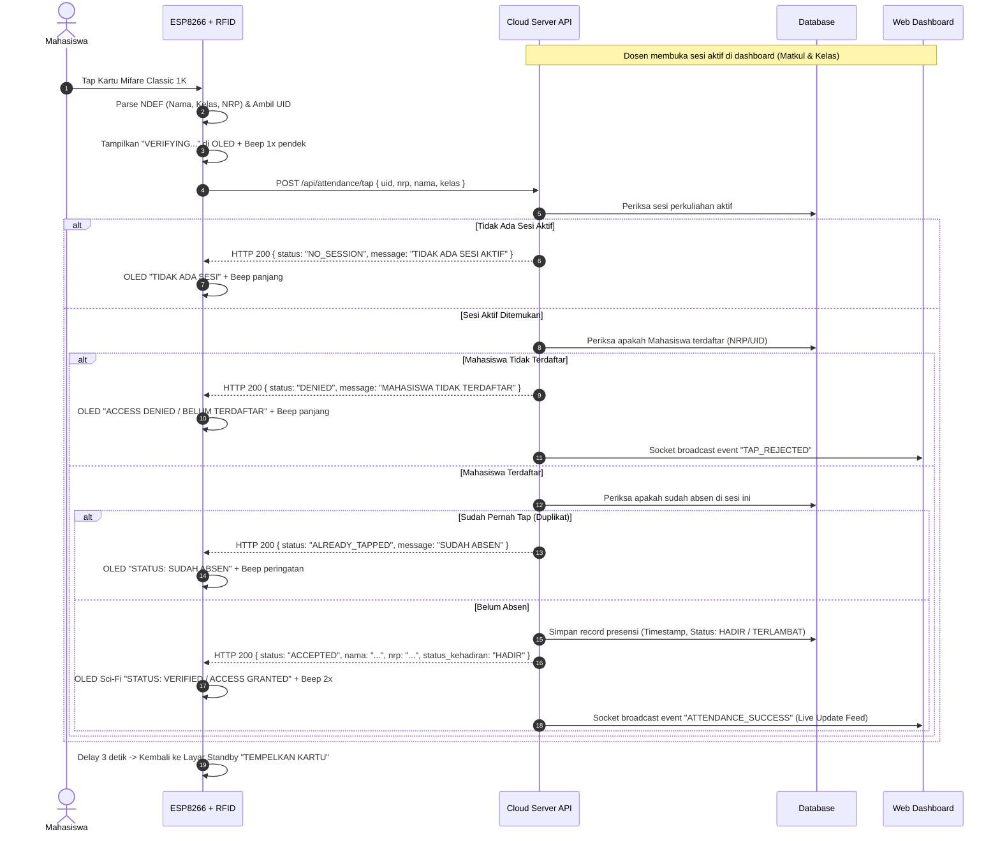
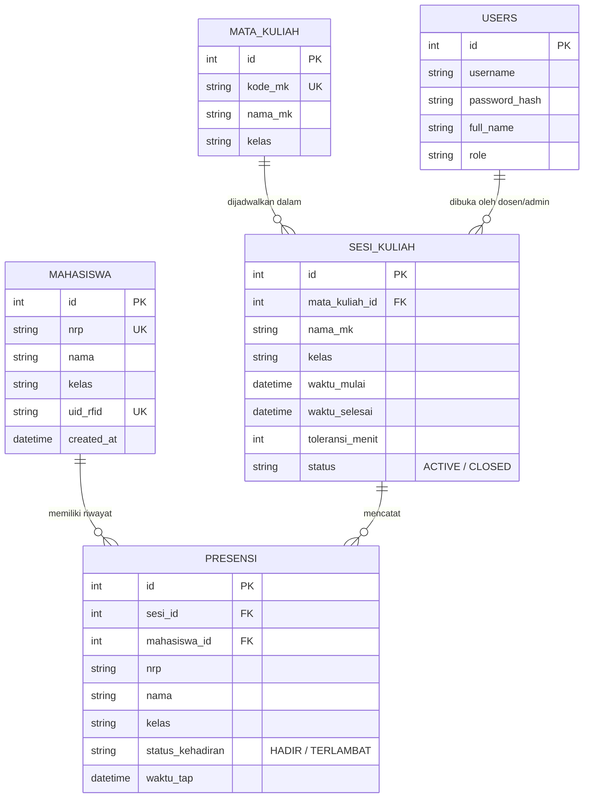

# Spesifikasi Arsitektur Sistem Presensi IoT: ESP8266 RFID & Web Dashboard

Dokumen ini mendefinisikan arsitektur lengkap, alur komunikasi data, spesifikasi API, skema database, serta mekanisme sinkronisasi antara perangkat keras (ESP8266 + RC522 + OLED + Buzzer) dan aplikasi Web Dashboard.

---

## 1. Ikhtisar Sistem & Arsitektur Tingkat Tinggi

```mermaid
flowchart LR
    subgraph Hardware ["Hardware Layer (ESP8266)"]
        RC522["RFID RC522<br/>(Mifare 1K NDEF)"] -->|SPI| ESP["ESP8266 NodeMCU"]
        ESP -->|I2C| OLED["OLED 0.96 SSD1306"]
        ESP -->|GPIO 2| BUZZ["Buzzer Piezo"]
    end

    subgraph Cloud ["Cloud Server (Node.js + Express)"]
        API["REST API Endpoint<br/>/api/attendance/tap"]
        WS["WebSocket Server<br/>(Socket.io)"]
        AUTH["Auth & Session Controller"]
        DB[(Database<br/>PostgreSQL / SQLite)]
        
        API --> DB
        AUTH --> DB
        API -->|Broadcast Event| WS
    end

    subgraph Client ["Client Layer (Web Dashboard)"]
        Browser["Admin / Dosen Browser<br/>(Tailwind CSS + Clean Modern UI)"]
        WS -->|Realtime Tap Feed| Browser
        Browser -->|Open/Close Session, CRUD| API
    end

    ESP -->|HTTP POST JSON via WiFi/Internet| API
    API -->|HTTP JSON Response (ACC / DENIED)| ESP
```

---

## 2. Alur Kerja & Mesin Kondisi (State Machine)

### 2.1 Alur Tap Kartu & Validasi Presensi



---

## 3. Spesifikasi Kontrak API (REST API)

### 3.1 Endpoint Presensi ESP8266 (Tap Card)
- **URL:** `POST /api/attendance/tap`
- **Headers:** `Content-Type: application/json`
- **Request Body (JSON):**
```json
{
  "uid": "A34B22F1",
  "nrp": "5324600006",
  "nama": "Rafif Nuha",
  "kelas": "3 D4 TRM A"
}
```

- **Response Body:**
  - **Skenario 1: Berhasil (Accepted):**
    ```json
    {
      "success": true,
      "status": "ACCEPTED",
      "code": 200,
      "message": "Presensi Berhasil",
      "data": {
        "nama": "Rafif Nuha",
        "nrp": "5324600006",
        "kelas": "3 D4 TRM A",
        "timestamp": "2026-10-26T16:15:00.000Z",
        "status_presensi": "HADIR"
      }
    }
    ```
  - **Skenario 2: Ditolak - Mahasiswa Belum Terdaftar (Denied):**
    ```json
    {
      "success": false,
      "status": "DENIED",
      "code": 403,
      "message": "Akses Ditolak: Mahasiswa Belum Terdaftar"
    }
    ```
  - **Skenario 3: Ditolak - Sudah Absen Sebelumnya (Already Tapped):**
    ```json
    {
      "success": false,
      "status": "ALREADY_TAPPED",
      "code": 409,
      "message": "Peringatan: Anda Sudah Melakukan Absen Pada Sesi Ini"
    }
    ```
  - **Skenario 4: Ditolak - Tidak Ada Sesi Aktif (No Session):**
    ```json
    {
      "success": false,
      "status": "NO_SESSION",
      "code": 400,
      "message": "Tidak Ada Sesi Perkuliahan Aktif"
    }
    ```

---

### 3.2 Endpoint Manajemen Sesi & Dashboard
- `POST /api/auth/login`: Autentikasi admin (username & password).
- `GET /api/session/active`: Mengambil info sesi perkuliahan yang sedang berjalan.
- `POST /api/session/start`: Membuka sesi baru (pilih Mata Kuliah, Kelas, Batas Toleransi Menit).
- `POST /api/session/close`: Menutup sesi yang sedang aktif.
- `GET /api/students`: Mendapatkan daftar seluruh master data mahasiswa.
- `POST /api/students`: Mendaftarkan mahasiswa baru secara manual.
- `PUT /api/students/:id`: Mengubah data mahasiswa / memperbarui nomor UID.
- `DELETE /api/students/:id`: Menghapus data mahasiswa.
- `GET /api/attendance/logs`: Mengambil riwayat log presensi (filter sesi / tanggal) & export CSV.

---

## 4. Desain Skema Database



---

## 5. Spesifikasi Web Dashboard (Clean Modern Minimalist)

### 5.1 Tata Letak & Halaman
1. **Login Page:**
   - Card sederhana di tengah layar dengan background subtle gray (`slate-50` / `slate-900`), form login aman.
2. **Main Navigation Bar:**
   - Indikator status koneksi (Server Online, Sesi Aktif/Nonaktif, WebSocket Connected dot hijau).
   - Menu: **Live Monitor**, **Sesi Perkuliahan**, **Data Mahasiswa**, **Riwayat Presensi**.
3. **Live Monitor Page (Halaman Utama):**
   - **Header Card:** Info sesi yang aktif saat ini (Nama Matkul, Kelas, Jam Mulai, Tombol Tutup Sesi Cepat).
   - **Statistik Cepat:** 3 widget kartu: Total Hadir, Terlambat, Kartu Ditolak.
   - **Real-Time Tap Stream Feed:** Komponen feed interaktif yang otomatis muncul (animasi slide-in) setiap kali kartu di-tap di reader. Warna badge:
     - Hijau: `HADIR`
     - Kuning: `TERLAMBAT`
     - Merah: `DITOLAK (UNREGISTERED)`
     - Biru/Abu: `SUDAH ABSEN`
4. **Halaman Data Master Mahasiswa:**
   - Tabel responsif berisi Nama, NRP, Kelas, dan UID Kartu.
   - Modal form untuk Tambah Mahasiswa dan Edit Mahasiswa.
5. **Halaman Riwayat & Export:**
   - Filter dropdown berdasarkan Sesi / Tanggal.
   - Tombol **Export to CSV / Excel** untuk rekap presensi.

---

## 6. Penyesuaian Firmware ESP8266

### 6.1 Optimasi Memori & Konektivitas
- Karena pemakaian IRAM ESP8266 sudah ~93%, library HTTP client harus seringan mungkin:
  - Menggunakan `ESP8266HTTPClient` bawaan dan `WiFiClient` (jika HTTP) atau `WiFiClientSecure` dengan `client.setInsecure()` (jika HTTPS pada domain cloud publik).
  - Parsing JSON respon sederhana menggunakan `ArduinoJson` (v6/v7) dengan buffer statis kecil (~256 byte).

### 6.2 Pola State Tampilan OLED
1. **Idle / Standby:** `"SISTEM IDENTIFIKASI"` + `"TEMPELKAN KARTU RFID / NFC..."`
2. **Saat Kartu Terdeteksi:** `"MENGIRIM DATA..."` / `"VERIFYING..."` (Beep 1x pendek)
3. **Respon Diterima:**
   - **Status `ACCEPTED`:** Menampilkan Header `"IDENTIFIKASI MAHASISWA"`, Nama, Kelas, NRP, dan Footer Box Sci-Fi `"STATUS: VERIFIED" / "ACCESS GRANTED"` + 2x beep.
   - **Status `DENIED`:** Header `"AKSES DITOLAK"`, Nama & NRP kartu, dan Footer Box `"BELUM TERDAFTAR"` + 1x beep panjang (~800ms).
   - **Status `ALREADY_TAPPED`:** Header `"PERINGATAN"`, Footer Box `"SUDAH ABSEN"` + 1x beep pendek.
   - **Status `NO_SESSION`:** Header `"PERINGATAN"`, Footer Box `"TIDAK ADA SESI"` + 1x beep pendek.
4. **Timeout:** Setelah 3 detik, OLED otomatis kembali ke layar standby.
